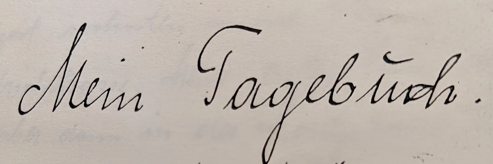

# Mein Tagebuch

**Helene Martha Schaarschmidt, geboren 1903 in Plauen · Aufzeichnungen 1903–1959**

### 📖 [Jetzt lesen (PDF)](pdf/Mein_Tagebuch.pdf)

[Read in English](#in-english) · [Die Handschrift ansehen (Scan, PDF)](pdf/Mein_Tagebuch_Handschrift.pdf)

Helene Penzel kam 1903 als Tochter eines Klempners in Plauen zur Welt. Ihr Buch beginnt mit einem kurzen Blick zurück auf Kindheit und Jugend und wird ab 1928 zu einem Tagebuch, das sie bis Januar 1959 führt. Es geht um Tanzstunden und Bälle, die Inflation, ihre Arbeit in Plauener Kaufhäusern, die Liebe zu Walter, Hochzeit und Kinder, dann um die NS-Zeit, den Krieg, Walters Tod, die Bomben auf Plauen und den Neuanfang. Sie schreibt einfach und direkt, oft am selben Tag: „Heute, Sonntag, den 20.8.33, sitze ich hier allein zu Hause …“

Zum Lesen braucht man etwa eine halbe Stunde.

## Worum es geht

- **1914–1918:** Der Vater wird in den ersten Kriegstagen eingezogen und ist in Russland. Zu ihrer Konfirmation 1918 kann er nicht heimkommen.
- **1920er Jahre:**
  - Sie arbeitet als Verkäuferin, als Garniererin, als Mustermädchen bei Gebr. Lange und als Kassiererin im Kaufhaus Hermann Tietz und in der Epa.
  - 1920/21 geht sie zur Tanzstunde und auf Bälle.
  - In der Inflation von 1923 kostet ein Brot 5 Millionen Mark.
  - 1928 macht sie Sommerfrische bei Bayreuth.
- **1931–1934:**
  - Ostern 1931 lernt sie Walter Schaarschmidt aus Neuensalz kennen.
  - Am 1. April 1933 wird ihr Geschäft boykottiert und von Nazis besetzt, und die jüdischen Angestellten müssen gehen.
  - Eine Woche vor ihrer Hochzeit wird ein Cousin von seinen eigenen Kameraden erschlagen.
  - Am 17. März 1934 heiratet sie Walter. Am Morgen danach erkrankt er schwer an einer Lungenentzündung.
- **1935–1939:**
  - 1935 kommt die Tochter Margot zur Welt, 1937 der Sohn Günter.
  - Walter leidet an einer chronischen Hautkrankheit und fährt von Kur zu Kur.
  - Die Sudetenkrise 1938 bringt die ersten Verdunkelungen, im September 1939 beginnt der Krieg.
  - Ihr Bruder ist als Pionier in Frankreich und später in Russland.
- **1940–1943:**
  - Es gibt Lebensmittelkarten und Sammlungen für die Front, und die Städte im Westen werden bombardiert.
  - Weihnachten 1941 wird ihr sechsjähriger Neffe von einem Kohlenauto überfahren.
  - Walter kann nicht mehr arbeiten, und sie trägt Zeitungen aus.
  - Ende August 1943 stirbt Walter nach einer Woche Krankheit zu Hause. Sie beschreibt diese Tage Stunde für Stunde.
- **1944–1945:**
  - Fast täglich ist Fliegeralarm.
  - Im März 1945 wird die Familie ausgebombt. Den schwersten Angriff auf Plauen überlebt sie in einem Erdloch, das ihr Vater im Garten ausgebaut hat.
  - Danach flieht sie mit den Kindern zu Verwandten nach Raun. Die Wohnung wird geplündert, und es folgt der Hunger.
- **1946–1959:**
  - Der Vater stirbt 1946, die Mutter 1949.
  - Margot lernt in der Damenkonfektion. Günter wird Schlosser, studiert an der Arbeiter-und-Bauern-Fakultät in Leipzig und wird Offizier der Volksarmee.
  - Beide heiraten 1957 und bekommen 1958 je ein Kind.
  - Der letzte Eintrag vom 19. Januar 1959 endet: „Ich habe meine Pflicht getan, nun müssen sie sich selbst durchs Leben helfen.“

## Zu dieser Ausgabe

- **Lesefassung:** Rechtschreibung und Zeichensetzung folgen heutigen Regeln, offensichtliche Grammatikfehler sind berichtigt. Ihre Wörter, ihr Satzbau und ihre Ausdrucksweise sind geblieben.
- **Zeichen im Text:**
  - Wörter in eckigen Klammern [ ] fehlen in der Handschrift und wurden ergänzt.
  - (?) steht hinter einer unsicheren Lesung.
  - Die Zahlen am Rand nennen die Seite der Handschrift.
- **Fußnoten** erklären Stellen, an denen sie sich in einem Datum oder einer Tatsache geirrt hat oder an denen das Original anders lautet.
- **Politik:** Sie schrieb für sich selbst. Was sie über die Politik ihrer Zeit festhält, gibt wieder, was sie damals hörte und las, oft in der Sprache der NS-Propaganda. Es ist ihre Sicht als Zeitgenossin, nicht die dieser Ausgabe.
- **Entstehung:**
  - Die Abschrift entstand mit Hilfe von KI und wurde Seite für Seite mit dem Scan verglichen. Einzelne Lesefehler sind trotzdem möglich.
  - Vorlage ist eine Fotokopie aus dem Besitz ihrer Tochter Margot (geb. 1935).

---

## In English

### 📖 [Read the English translation (PDF)](pdf/My_Diary.pdf)

Helene Martha Penzel was born on 14 November 1903 in Plauen, Saxony, the daughter of a plumber. Her book looks back briefly on her childhood and youth and from 1928 becomes a diary, kept until January 1959. She is an ordinary working woman writing for herself, often on the very day ("Today, Sunday 20.8.33, I am sitting here alone at home"). The large events of her time enter the diary as they reached her through work, family, radio and newspapers, at times in the words of the regime's own propaganda. Reading it takes about half an hour.

- **1914–1918:** Her father is called up in the first days of the war and serves in Russia; he is still away when she is confirmed in 1918.
- **1920s:**
  - She works as a saleswoman, a milliner's trimmer, a pattern girl at Gebr. Lange, and a cashier at the Hermann Tietz department store and then at the Epa store.
  - She takes dance lessons and goes to balls in 1920–21.
  - In the inflation of 1923 a loaf of bread costs 5 million marks.
  - She spends a summer holiday near Bayreuth in 1928.
- **1931–1934:**
  - She meets Walter Schaarschmidt of Neuensalz at Easter 1931.
  - On 1 April 1933 her store is boycotted and occupied by Nazis, and its Jewish employees are dismissed.
  - A week before her wedding a cousin is beaten to death by his own comrades.
  - She marries Walter on 17 March 1934; the next morning he falls seriously ill with pneumonia.
- **1935–1939:**
  - Her daughter Margot is born in 1935 and her son Günter in 1937.
  - Walter suffers from a chronic skin disease and goes from one cure to the next.
  - The Sudeten crisis of 1938 brings the first blackouts, and in September 1939 the war begins.
  - Her brother serves as a pioneer in France and later in Russia.
- **1940–1943:**
  - Rationing, collections for the front, and the bombing of the western cities.
  - At Christmas 1941 her six-year-old nephew is killed by a coal lorry.
  - Walter can no longer work, and she delivers newspapers.
  - At the end of August 1943 Walter dies at home after a week of illness, which she describes hour by hour.
- **1944–1945:**
  - Air-raid alarms come almost daily.
  - In March 1945 the family is bombed out. She lives through the heaviest raid on Plauen in a dugout her father built in the garden.
  - She then flees with the children to relatives in Raun until the end of the war. Their flat is looted, and hunger follows.
- **1946–1959:**
  - Her father dies in 1946 and her mother in 1949.
  - Margot trains in a women's clothing workshop. Günter becomes a fitter, studies at the Workers' and Peasants' Faculty in Leipzig and becomes an officer in the National People's Army.
  - Both children marry in 1957 and each has a child in 1958.
  - The last entry, dated 19 January 1959, ends: "I have done my duty; now they must make their own way through life."

The English text is a translation of the German reading edition, which remains the authoritative text.

---

**Dateien / Files:**
- [`Deutsch.tex`](Deutsch.tex) and [`English.tex`](English.tex) are the LaTeX sources.
- `./build.sh` rebuilds the PDFs in [`pdf/`](pdf/).
- The editorial rules are in [`docs/adr/`](docs/adr/).
- The full-resolution scan (90 MB) is [here](Mein%20Tagebuch__Helene%20Martha%20Schaarschmidt.pdf).
- Licence: CC0 1.0.

